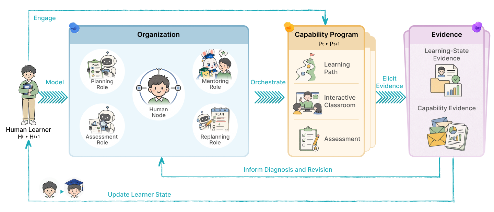
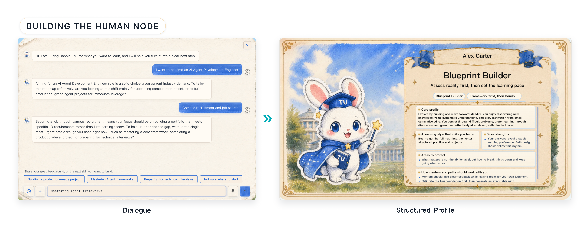
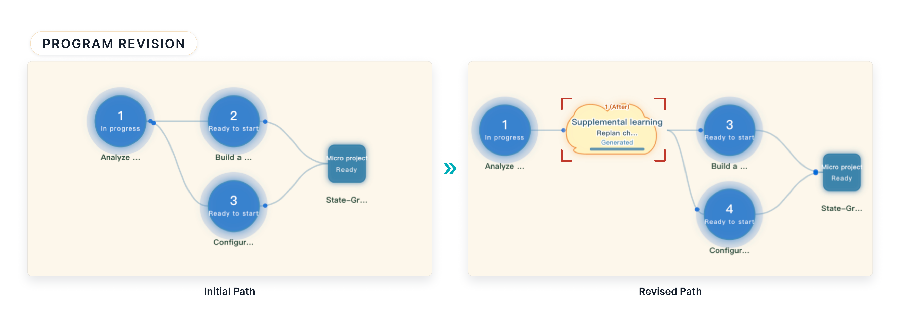

<div align="center">
  
  <h1> Agentic University · 图灵学社</h1>
  <p>One Learner, One University.</p>
  <p>Collaborative Agents for Personalized Learning</p>
  <p>
    <a href="https://arxiv.org/abs/2610.40492"></a>
    <a href="https://www.turingu.cn"></a>
    <a href="https://agenticorglab.github.io/AgenticUniversity/"></a>
  </p>
  <p>English | <a href="./README_CN.md">中文</a></p>
</div>

### 🎓 Overview

Agentic University (AU, 图灵学社 / TuringUnion) brings learners and specialized agents together in a Human-Participatory Multi-Agent Organization. Each learner helps maintain a revisable Capability Program that connects personal goals, learning activities, and assessment. Questions, feedback, and assessed performance inform the support that comes next.

<a id="framework"></a>

### 🧩 System Framework

AU coordinates four functional roles—planning, mentoring, assessment, and replanning—through a shared Human Node and Capability Program. Multiple agents can collaborate within each role.

<p align="center">
  <a href="./img/paper/framework.png"></a>
</p>

#### 1. Human Node: a persistent, correctable learner representation

The Human Node keeps the learner's profile, current state, and selected shared memory: background, preferences, time constraints, goals, progress, capability estimates, difficulties, earlier support, and revisions. Intake dialogue establishes these records. Explicit learner statements take priority over inferred defaults, and learners can correct goals or assumptions throughout learning. Prior exposure is recorded separately from demonstrated capability.

<details>
<summary>View the intake dialogue and structured learner profile</summary>



</details>

#### 2. Capability Program: connect goals, activities, and assessment

The Capability Program joins four components:

| Component | Responsibility |
| --- | --- |
| Learning Path | Stages and knowledge-point nodes linked by prerequisites and progression conditions. |
| Interactive Classroom | Node-specific documents, instructional videos, Pause-QA, and mentor dialogue. |
| Assessment | Tasks, assessed dimensions, permitted support, and grading criteria. |
| Program State | Active path version, completed and remaining work, evidence, and revision history. |

Planning uses the Human Node alongside career reference paths, capability graphs, and job descriptions. Each node links its objective to materials, mentor support, and assessment requirements; stage and program goals guide broader applied tasks.

#### 3. Instruction, layered assessment, and two kinds of evidence

The Interactive Classroom combines generated videos, written materials, questions at key teaching points (Pause-QA), and context-aware mentor support. Assessment expands in scope:

1. Chapter assessments check understanding after each knowledge-point node.
2. Stage micro-projects test application across several nodes with explicit outputs and criteria.
3. An enterprise simulation examines integration across stages in a simulated workplace task.

Learning-State Evidence from questions, retries, and reported difficulties guides teaching and support. Capability Evidence from assessed work updates capability estimates only within the tested dimensions and assistance conditions. Evidence records retain the observation, source and conditions, relevant claim, time, confidence or quality, and permitted updates. Asking for a hint can guide support; it does not by itself establish a capability judgment.

<p align="center">
  <a href="./img/paper/capability-program.jpg"></a>
</p>

#### 4. Evidence-guided revision with learner confirmation

AU updates state by combining compatible evidence (add), updating authorized fields while retaining history (replace), and preserving inconsistent observations for diagnosis (keep conflicts).

The Replanner brings together an evidence auditor, process observer, and outcome examiner. All three assess concept, transfer, and independence under a shared rubric. Substantial disagreement triggers bounded peer review; final estimates are aggregated using normalized, self-reported confidence weights.

When a diagnosed gap warrants intervention, a concept gap guides prerequisite instruction before the affected node, while transfer or independence gaps guide practice after it. Local revisions respect insertion and branch-depth limits, preserve completed work and the surrounding sequence, and specify the new activity's objective and assessment. If no intervention is needed, AU retains the path. Changes take effect after learner confirmation, with evidence, diagnosis, and path versions linked in the revision record.

<p align="center">
  <a href="./img/paper/program-revision.jpg"></a>
</p>

### 🎬 Demo Videos

Watch the promotional film and five feature demos on the [project site](https://agenticorglab.github.io/AgenticUniversity/), or browse the [videos folder](./videos/). The demos illustrate learner profiling, personalized paths, mentor collaboration, interactive classrooms, and project practice.

<a id="evaluation"></a>

### 📊 Preliminary Evaluation

In a short-term study focused on becoming an AI video generation product manager, the AU group achieved a mean pre-to-post gain in objective assessment scores 6.58 points larger than the comparison group (50-point scale; 16 learners per group). Study procedures and full results are available in the [paper](https://arxiv.org/html/2610.40492v1#S5).

### 📄 Paper & Citation

```bibtex
@article{fan2026agenticuniversity,
  title={Agentic University: Collaborative Agents for Personalized Learning},
  author={Fan, Jingru and Zhou, Tianle and Zhou, Yunjie and He, Zihao and
          Zhou, Yixuan and Wu, Kezhao and Zheng, Xinyu and Wang, Xiyuan and
          Wang, Yuheng and Li, Zhi and Liu, Songhua and E, Weinan and Qian, Chen},
  journal={arXiv preprint arXiv:2610.40492},
  year={2026},
  url={https://arxiv.org/abs/2610.40492}
}
```

---

## 👥 Contributors

<p>
  <a href="https://github.com/ffcosmos"></a>
  <a href="https://github.com/lonelyness1"></a>
  <a href="https://github.com/WilsonWukz"></a>
  <a href="https://github.com/TL-Z"></a>
  <a href="https://github.com/hendrick-wang"></a>
  <a href="https://github.com/RedRoman"></a>
  <a href="https://github.com/xdedmyyds"></a>
  <a href="https://github.com/turingw1"></a>
  <a href="https://github.com/Deep-Octopus"></a>
  <a href="https://github.com/warmazxy-maker"></a>
  <a href="https://github.com/Qianc62"></a>
</p>

## 📬 Contact

- Website: <https://www.turingu.cn>
- Email: <qianc62@gmail.com> / <aohan510@gmail.com>
