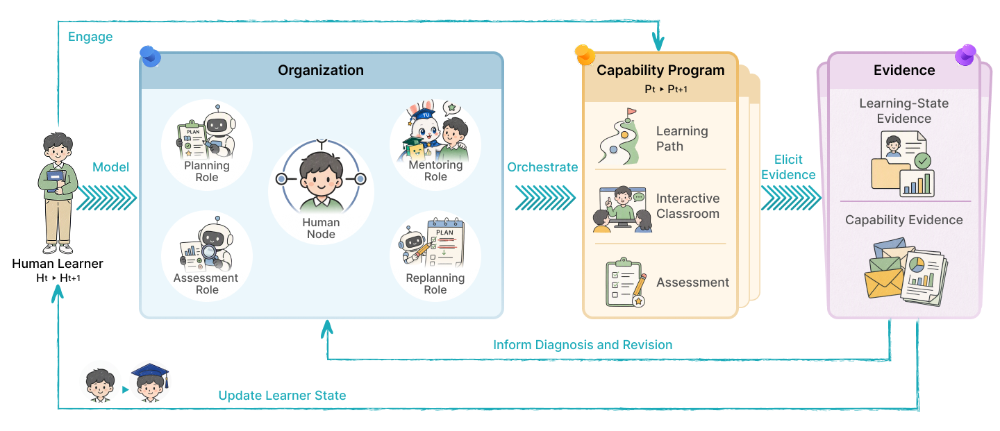
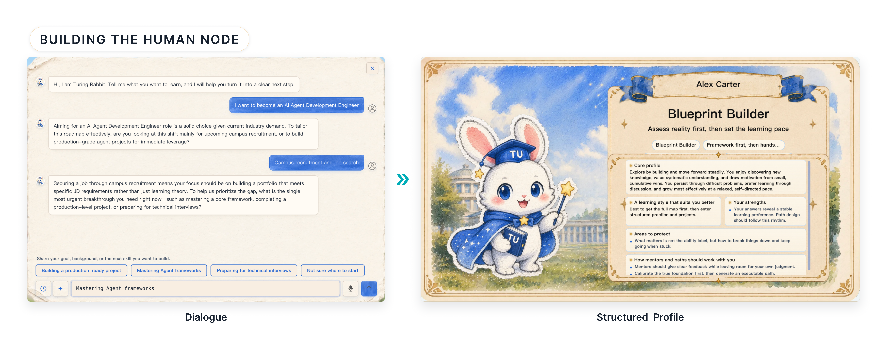
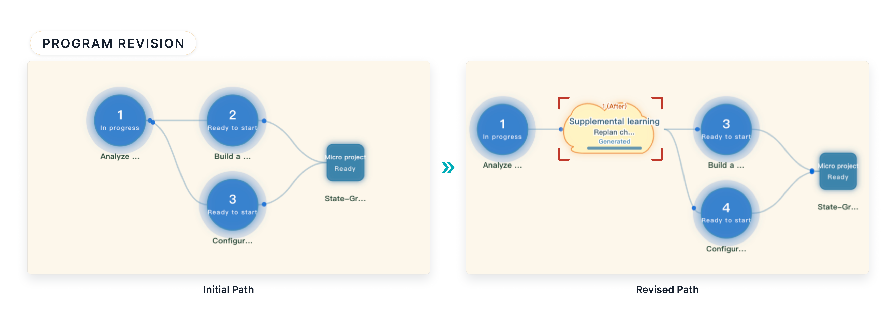

<div align="center">
  
  <h1> Agentic University · 图灵学社</h1>
  <p>一人一大学。</p>
  <p>Collaborative Agents for Personalized Learning</p>
  <p>
    <a href="https://arxiv.org/abs/2610.40492"></a>
    <a href="https://www.turingu.cn"></a>
    <a href="https://agenticorglab.github.io/AgenticUniversity/"></a>
  </p>
  <p><a href="./README.md">English</a> | 中文</p>
</div>

### 🎓 项目概述

Agentic University（AU，图灵学社 / TuringUnion）采用人类参与式多智能体组织（Human-Participatory Multi-Agent Organization），让学习者作为组织成员，与专业智能体共同维护一份可持续修订的能力培养方案（Capability Program）。方案连接个人目标、学习活动与评估，并用提问、反馈和评估表现指导后续支持。

<a id="framework"></a>

### 🧩 系统框架

AU 通过共享的人类节点与能力培养方案，协调规划、导师、评估、重规划四类职能，每类职能可由多个智能体协作承担。

<p align="center">
  <a href="./img/paper/framework.png"></a>
</p>

#### 1. 人类节点：可持续维护、可纠正的学习者表征

Human Node 包含画像、当前状态与精选共享记忆，记录背景、偏好、时间约束、目标、进度、能力估计、困难、既往支持与方案修订。系统通过入学对话建立这些记录，明确的学习者陈述优先于推断或默认值，学习者可以持续纠正目标与系统假设。既往接触经历与已被评估证实的能力分开记录。

<details>
<summary>查看入学对话与结构化学习者画像</summary>



</details>

#### 2. 能力培养方案：连接目标、活动与评估

Capability Program 由四部分共同构成：

| 组成 | 职责 |
| --- | --- |
| 学习路径（Learning Path） | 将阶段与知识点节点按先修关系、任务开放和推进条件连接。 |
| 交互课堂（Interactive Classroom） | 提供节点对应的文档、教学视频、Pause-QA 和导师对话。 |
| 评估（Assessment） | 明确任务、评估维度、允许的辅助与评分标准。 |
| 方案状态（Program State） | 记录当前路径版本、已完成与剩余任务、证据和修订历史。 |

规划模块结合人类节点、职业参考路径、能力图谱和岗位描述确定目标技能与先修要求。每个节点将学习目标与材料、导师支持和评估相连；阶段与整体目标进一步指导应用任务的设计。

#### 3. 教学、分层评估与两类证据

交互课堂将生成式教学视频、文字材料、关键教学点的暂停问答（Pause-QA）与情境化导师支持组织在同一知识点下。评估范围逐层扩展：

1. 章节评估：在每个知识点节点之后检查理解。
2. 阶段微项目：通过明确交付物与评分标准，考察多个节点知识的应用。
3. 企业情境模拟：在模拟工作任务中考察跨阶段知识的综合运用。

提问、重试和困难反馈形成学习状态证据（Learning-State Evidence），用于调整讲解与支持；被评估的任务表现形成能力证据（Capability Evidence），只在实际测量的维度与辅助条件内更新能力估计。证据记录保留观察、来源与条件、相关判断、时间、置信度或质量，以及允许支持的更新。请求提示可以说明支持需求，但不能单独证明能力水平。

<p align="center">
  <a href="./img/paper/capability-program.jpg"></a>
</p>

#### 4. 证据驱动修订，由学习者确认生效

AU 采用三类状态更新规则：add 合并兼容证据，replace 在来源允许时更新字段并保留历史，keep conflicts 保留矛盾观察供后续诊断。

Replanner 协调证据审计者、过程观察者和结果检查者，三者都按照同一标准评估概念、迁移与独立性。分歧超出预设容差时触发有限轮次的互评，最终以归一化的自报置信度权重聚合估计。

当诊断出的差距达到干预条件时，概念差距指导在受影响节点之前补充先修教学，迁移或独立性差距指导在其之后增加练习。局部修订受分支深度和插入次数限制，保留已完成内容及周边顺序，并明确新增活动的目标与评估要求；无需干预时保留原路径。路径变更经学习者确认后生效，修订记录连接支持证据、诊断、调整与路径版本。

<p align="center">
  <a href="./img/paper/program-revision.jpg"></a>
</p>

<a id="demo-videos"></a>

### 🎬 功能演示

在[项目主页](https://agenticorglab.github.io/AgenticUniversity/)观看宣传片和五个功能演示，或浏览 [videos 文件夹](./videos/)。演示涵盖学习者画像、个性化路径、多智能体导师、交互课堂和项目实践。

<a id="evaluation"></a>

### 📊 初步验证

在以“AI 视频生成产品经理”为学习目标的短期研究中，AU 组在客观评估上的前后测平均提升幅度较对照组多 6.58 分（50 分制，每组 16 名学习者）。研究设置与完整结果见[论文](https://arxiv.org/html/2610.40492v1#S5)。

### 📄 论文与引用

```bibtex
@article{fan2026agenticuniversity,
  title={Agentic University: Collaborative Agents for Personalized Learning},
  author={Fan, Jingru and Zhou, Tianle and Zhou, Yunjie and He, Zihao and
          Zhou, Yixuan and Wu, Kezhao and Zheng, Xinyu and Wang, Xiyuan and
          Wang, Yuheng and Li, Zhi and Liu, Songhua and E, Weinan and Qian, Chen},
  journal={arXiv preprint arXiv:2610.40492},
  year={2026},
  url={https://arxiv.org/abs/2610.40492}
}
```

---

<a id="contributors"></a>

## 👥 贡献者

<p>
  <a href="https://github.com/ffcosmos"></a>
  <a href="https://github.com/lonelyness1"></a>
  <a href="https://github.com/WilsonWukz"></a>
  <a href="https://github.com/TL-Z"></a>
  <a href="https://github.com/hendrick-wang"></a>
  <a href="https://github.com/RedRoman"></a>
  <a href="https://github.com/xdedmyyds"></a>
  <a href="https://github.com/turingw1"></a>
  <a href="https://github.com/Deep-Octopus"></a>
  <a href="https://github.com/warmazxy-maker"></a>
  <a href="https://github.com/Qianc62"></a>
</p>

<a id="contact"></a>

## 📬 联系我们

- 网址：<https://www.turingu.cn>
- 邮箱：<qianc62@gmail.com> / <aohan510@gmail.com>
